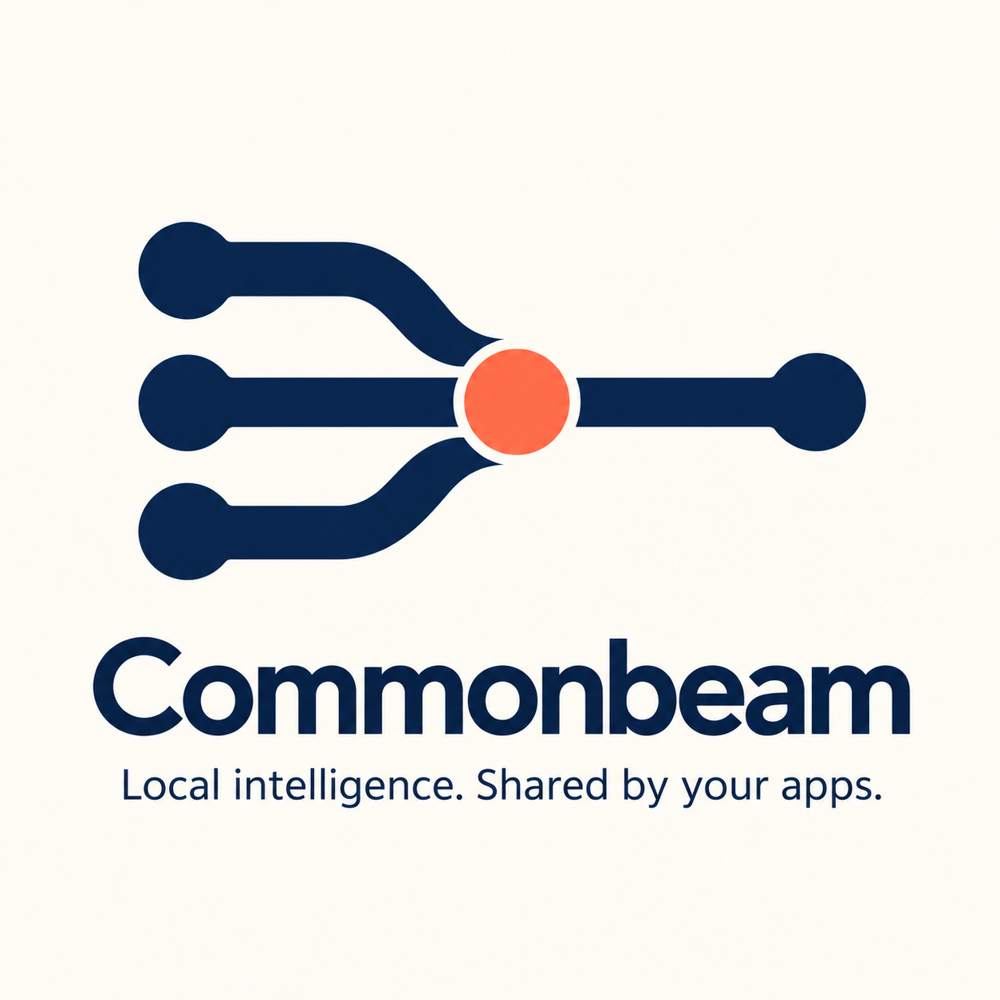
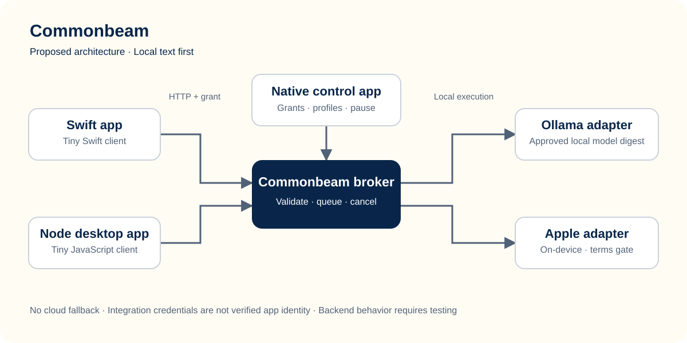

<p align="center"></p>

# Commonbeam

**Local intelligence. Shared by your apps.**

A shared local-AI connection for Mac apps. Your app owns the experience;
Commonbeam owns integration grants, capability negotiation, queues and cancellation.

> **Phase 1 developer preview.** Exercise the broker and SDKs using explicit
> synthetic test mode. It returns labelled test text, **not AI output**. Ollama is
> the intended next adapter. No inference engine or model is bundled or installed.



*Target design: the Apple and Ollama adapters shown are not shipped in Phase 1.*

## Try it without a model

Apple silicon, macOS 26+, Swift 6.2+ and Node 22+ are required. Building fetches
Swift source dependencies, not model weights.

```sh
git clone https://github.com/sintaxerrorpvtltd/commonbeam.git
cd commonbeam
swift build
swift run CommonbeamFixtureServer 52441 /tmp/commonbeam-demo-grants
```

The grant directory must not already exist. The server creates private `node.secret`
and `swift.secret` files without printing credentials, and removes them on graceful
shutdown. In a second terminal, from the repository root:

```sh
COMMONBEAM_TOKEN_FILE=/tmp/commonbeam-demo-grants/node.secret \
  node examples/node-notes/main.mjs

cd examples/swift-rewriter
COMMONBEAM_TOKEN_FILE=/tmp/commonbeam-demo-grants/swift.secret swift run
```

Two callers, distinct grants, one broker. The fixture adapter does not echo prompts;
its canned response exists only to exercise integration and failure handling.

## A tiny client contract

Node uses only standard libraries. No npm package has been published; import source:

```js
import { Commonbeam } from './packages/sdk-js/index.js';
const beam = new Commonbeam({ token: grantFromSecureStorage });
const profile = (await beam.capabilities()).require('fixture-text');
for await (const event of beam.text.stream({
  profile, messages: [{ role: 'user', content: 'Rewrite this clearly: …' }]
})) {
  if (event.type === 'delta') process.stdout.write(event.text);
}
```

Swift uses the independent local package at `packages/CommonbeamKit`:

```swift
let beam = try CommonbeamClient(token: grantFromKeychain)
let profile = try await beam.capabilities().require("fixture-text")
let result = try await beam.text.generate(
    profile: profile, messages: [.user("Rewrite this clearly: …")]
)
```

These examples test the interface, not a rewrite model. Future real adapters use
the same contract with actual readiness and provenance. Both clients negotiate
before sending prompts and never automatically retry generation. Electron clients
must keep credentials in the main process, never the renderer.

## What is included

| Phase 1 | Later, not claimed |
|---|---|
| Numeric-loopback HTTP using Hummingbird 2.28.0 | Real Ollama inference and digest approval |
| Native grants, one-time display, revoke and pause | Apple adapter and terms review |
| Keychain-backed verifier key; private grant file | Developer ID signing/notarization |
| Revision-pinned capabilities and typed errors | Separately signed sandboxed demo apps |
| Bounded fair queues, rate limits and deadlines | Quality, offline and memory/latency benchmarks |
| JSON/NDJSON, cancellation and bounded output | Managed models, MLX, speech, browser clients |
| Swift/Node SDK sources and synthetic harness | Published registry packages |

Build the native control app with `sh scripts/package-app.sh`, then open
`dist/Commonbeam.app`. Select **Synthetic test mode** before starting to try the
grant flow. Normal mode reports no ready inference backend. The local build is
ad-hoc signed, not a notarized production download.

## Why another layer?

Ollama and Apple already provide model APIs. Commonbeam explores a consistent
developer contract, user-controlled access and scheduling across participating
apps. It cannot remove private models embedded in other apps or guarantee one
shared memory copy. Tell us where this reduces setup work—or where a direct API
already serves you better.

## Test and contribute

```sh
COMMONBEAM_SOCKET_TESTS=1 sh scripts/test.sh
sh scripts/test-e2e.sh
```

The second command runs both SDKs against the actual Swift HTTP service with
synthetic responses. CI never installs Ollama or downloads models. See
[evidence and limitations](docs/STATUS.md); fixture success is not provider or
offline-inference validation.

[Report a bug or integration feedback](https://github.com/sintaxerrorpvtltd/commonbeam/issues/new/choose) ·
[Contributing](CONTRIBUTING.md) · [Protocol](protocol/v1.md) ·
[Security](SECURITY.md) · [Roadmap](docs/ROADMAP.md)

Grants are bearer credentials labelled by users, **not signed-app identities**.
Anyone holding a token can use it. Same-user malware and administrators are outside
this boundary; direct backend access bypasses broker controls. No telemetry,
prompt/output logs, automatic downloads, shell tools or cloud fallback. OS memory
diagnostics and caller app behaviour remain outside these guarantees.

Apache-2.0 for project source and documentation; dependencies/models retain their
terms. Commonbeam is a working name, not a trademark-clearance claim.
Built by [Sintax Error](https://github.com/sintaxerrorpvtltd).
